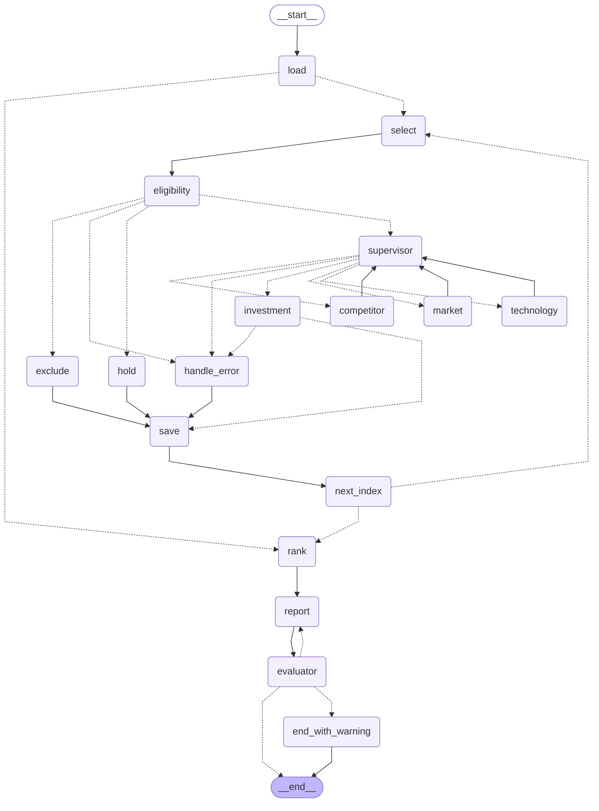

# Subject
본 프로젝트는 AI 반도체 스타트업을 하드웨어(AI 칩 설계)·소프트웨어(AI 기반 반도체 설계·공정) 두 진영에서 선정하여, 창업자·시장성·제품/기술력·경쟁 우위·실적 관점에서 투자 가능성을 평가하는 **Supervisor** 패턴 기반으로 설계/개발한 프로젝트임.

> **결과 한 줄** — 45개사 → 제외 27 · 보류 16 · **투자 적격 2** → 1위 **망고부스트코리아(DPU) 79.0점**, 2위 디노티시아 72.0점 (제출 trace `24e889d7ecf2`)
>
> 이전 RAG 과제(고정 순서 구조)는 [`rag-pjt`](https://github.com/kimhynsoo/skala-rag/tree/rag-pjt) 브랜치에 보존

## Overview
- Objective : 하나의 기업을 기술·시장·경쟁 복수 관점에서 근거 기반으로 비교 평가하고 투자 적격 여부를 판정
- Pattern : Supervisor — 근거 충분성 판단과 관점별 재작업이 평가 품질의 핵심이고, 종료 조건·fallback을 중앙에서 통제해야 하므로 선정. Orchestrator-Workers는 실행 전 1회 계획이라 중간 근거 부족을 되돌릴 수 없고, Agent-as-Tool은 정적 흐름에서 도구 호출과 차이가 없으며, Swarm은 재현성 보장이 어려워 제외
- 동적 처리 : 기존에는 `technology → market → competitor` 순서와 재검색 횟수가 엣지로 고정됐다. 지금은 Supervisor가 매 라운드 State(수집된 관점·근거 충분도·실패·실행 횟수)를 보고 `next`를 정한다. 기술·시장은 병렬로 실행하고, 세 관점이 모인 뒤 근거가 부족한 관점만 골라 재작업을 지시한다(LLM 판단 + 규칙 가드). 실행 횟수는 기업마다 다르다 (실측: Supervisor 라우팅 17회, 실행 수 technology 8·market 8·competitor 4, 재작업 8회, 품질 평가 [fail, pass])
  - LLM이 재작업 대상을 직접 고른 사례 (망고부스트코리아): 한 라운드는 "시장 규모·성장률 정보 부족"으로 **시장만**, 다음 라운드는 "성능 수치·측정 환경 미확인"으로 **기술만** 재작업을 지시한 뒤 투자 판단으로 넘어감
- 의도적 차이 : 강의 Supervisor는 매 스텝 LLM이 라우팅한다. 여기서는 필수 단계와 상한을 코드가 강제하고, 판단이 필요한 재작업 여부만 LLM에 맡긴다. 이유는 재현성과 비용(45개사)이다

## Selected Technologies
- SW : AI 기반 반도체 설계·공정 SW — 디렉토리북 45개사 중 3곳: C01 디에스(후공정 불량 검출), C30 서클(주문형 반도체 디자인), C34 싸이프(소자 모델링 SIMLAB). 3곳 모두 평가에 포함했고 결과는 C01·C30 보류, C34 제외
- HW : AI 반도체 칩 (NPU·DPU·AI 가속기) — IRDS·UCIe·CXL 기준값으로 성능을 정량 비교할 수 있고, 디렉토리북 시스템반도체 분야 45개사 중 나머지 기업이 해당

## Features
- PDF 자료 기반 정보 추출 (디렉토리북 45개사 + 기술 로드맵·시장 보고서 15개 PDF 169쪽)
- Supervisor 동적 라우팅: 관점별 근거 충분도 판단 → 부족한 관점만 재작업 (병렬)
- 확증 편향 방지 전략 : 보고서 인용 외부 출처 기관 3곳 이상·단일 기관 비중 50% 이하 룰 검사(평가 대상 기업 소개 자료는 계산 제외), LLM Judge가 불리한 근거(미확인·열위·리스크) 누락 검사, 투자 판정은 LLM이 아니라 코드 점수로만
- 보고서 품질 평가 : Hybrid(룰 + LLM Judge)로 Groundedness·중립성·편향 통제 판정, 미달 사유를 피드백으로 넣어 최대 2회 재작성 후 경고 종료
- 품질 평가 피드백 루프 실측 : 1차 보고서가 중립성 미달("국내에서 유일하게 DPU를 개발하며" → 금지 표현 `유일한`) → 미달 사유를 피드백으로 넣어 재작성 → 2차에서 3개 항목 모두 통과, 금지 표현 0건 (`report_attempts` 2, score 1.0, 인용 11건 모두 추적 가능, 외부 출처 기관 7곳·최다 비중 30%)

## Tech Stack
- Framework : LangGraph, LangChain, Python
- LLM/Generator : gpt-4.1-mini
- LLM/Judge : gpt-4.1-mini (Supervisor 재작업 판단, 품질 평가 Judge)
- Retrieval : Chroma + bge-m3 dense/sparse RRF — Hit Rate@5 0.944, MRR@5 0.917 ([비교 실험](eval/results.md))
- Embedding : BAAI/bge-m3
- Observability : LangSmith, JSONL 결정 로그

## Agents
- Supervisor : 기업별 분석 구간 통제. 규칙 ① step 상한 → 투자 판단 ② 기술 재시도 후 실패 → 보류 ③ 기술·시장 미수행/실패 → 병렬 실행 ④ 경쟁 미수행/실패 → 실행 ⑤ 근거 부족 관점 → LLM이 재작업 대상 또는 투자 판단 선택 ⑥ 충분·상한 → 투자 판단
- 기술 요약 [RAG] : IRDS·UCIe·CXL 기준값 대조, 재작업 사유로 질의 재작성
- 시장성 평가 [RAG] : SIA·WSTS·KIET·OECD 대조
- 경쟁사 비교 : RAG + Tavily, 기술·시장 결과를 비교 기준으로 사용
- 투자 판단 : 체크리스트 11문항 + 스코어카드 15항목, LLM 3회 채점 → 코드 집계·판정
- 보고서 생성 / 품질 평가 : SUMMARY·REFERENCE 포함 보고서 → 룰 + LLM Judge

**투자 판단 기준** — 가중치 창업자 20 · 시장성 20 · 제품/기술력 30 · 경쟁 우위 15 · 실적 15. **총점 70점 이상 + 기술력 평균 2.67 이상**이면 투자 적격 (이전 과제 3.0에서 조정).
- 근거 : 기술 3항목 중 확인 가능한 2개가 루브릭 기본점(3점) 이상이고, 공개 자료로 확인할 수 없는 항목(2점 처리)이 1개까지인 경우를 허용 → (3 + 3 + 2) / 3 = 2.67
- 3.0 기준에서는 확인 불가 항목이 하나라도 있으면 다른 항목이 4점이어야 해, 성능 지표가 비공개인 비상장 스타트업에 사실상 "확인 불가 0개"를 요구했다 (실측: 적격성을 통과한 4곳 모두 C3 핵심 기술 지표 확인 불가로 탈락)

## State Schema
- 제어 vs 페이로드 분리 : ② 흐름 제어(`next`, `step_count`, `max_steps`, `rework_reason`, `node_status`, `agent_attempts`, `last_error`)와 ③ 작업 산출물(`*_analysis`, `current_evidence`, `scorecard`)을 그룹으로 분리. 산출물은 Pydantic 스키마로 구조화(`근거ID` 포함)
- 관측성 위치 : 결정과 사유 전체는 `outputs/logs/{trace_id}.jsonl`(`{trace_id, company_id, node, decision, reason, ts}`)과 LangSmith로 분리. State에는 마지막 사유 1줄(`route_reason`)만
- 지속성 비용 : 기업 전환 시 ③과 제어 필드 리셋, 원문 전문은 `.cache/`에 두고 State는 발췌만. MemorySaver는 변경된 채널만 새 버전으로 저장
- 상관 : `trace_id` 하나를 State·JSONL 로그·LangSmith metadata·checkpointer `thread_id`에 동일하게 사용
- 재개/복구 : `node_status`(SUCCESS/FAILED), `agent_attempts`(재시도 횟수), `last_error`·`errors`(`{company_id, stage, type, error, ts}`)로 무엇을 재시도할지 판단. MemorySaver 스냅샷, 외부 조사 캐시
- 동시 처리 : 병렬 노드가 쓰는 `node_status`·`agent_attempts`는 `merge_dict`, `current_evidence`는 `merge_evidence`, `errors`·`evaluation_results`는 `operator.add`. 단일 값 키(`retrieve_count`) 제거, 검색기 Lock, `max_concurrency=4`
- 종료 보장 : 에이전트별 재작업 1회, 기업별 Supervisor 6스텝, 보고서 재생성 2회 후 `end_with_warning`, `recursion_limit=3000`

## Architecture


## Results
| 단계 | 기업 수 | 내용 |
|---|---|---|
| 적격성 G1~G4 | 45 | 적격 4 · 부적격 27 → 제외 · 확인 필요 14 → 보류 |
| 스코어카드 채점 | 4 | 망고부스트코리아(C03) 79.0 · 디노티시아(C25) 72.0 · 엑시나(C18) 62.7 · 아이디어스투실리콘(C07) 57.0 |
| **투자 적격** | **2** | 1위 망고부스트코리아 79.0점, 2위 디노티시아 72.0점. 엑시나·아이디어스투실리콘은 총점 70점 미만으로 보류 |

**투자 보고서** — [`outputs/report.pdf`](outputs/report.pdf) (망고부스트코리아, 5쪽, SUMMARY·REFERENCE 포함). 전체 결과는 [`outputs/evaluation_results.json`](outputs/evaluation_results.json), 결정 로그는 [`outputs/logs/24e889d7ecf2.jsonl`](outputs/logs/24e889d7ecf2.jsonl)

## Lessons Learned
1. **라이브러리 충돌은 실측으로만 드러난다** — FAISS와 torch(bge-m3)가 각자 OpenMP를 싣고 와 macOS에서 프로세스가 죽었다. 결과가 같은 Chroma로 교체
2. **병렬화는 숨은 공유 자원을 드러낸다** — 기술·시장을 병렬로 돌리자 단일 값 키(`retrieve_count`) 동시 쓰기 오류와, 검색기 첫 적재 경합(bge-m3 이중 적재로 CPU 196% 정지)이 생겼다. 키 제거·리듀서·Lock으로 해결
3. **피드백 없는 재생성은 같은 실수를 반복한다** — 같은 입력으로 보고서를 다시 쓰면 같은 금지 표현이 나왔다. 미달 사유를 피드백으로 넣은 뒤에야 2차에서 통과
4. **편향 룰은 무엇을 셀지가 중요하다** — 기업 자체 소개 자료(DIR)까지 출처로 세면 단일 출처 비중이 항상 50%를 넘었다. 외부 출처만 세도록 수정
5. **엄격한 검증에는 비용이 따른다** — 근거 충분성이 거의 매번 False라 재작업이 반복된다. 원인이 기업 자료 부족이면 재작업으로 해결되지 않으므로 재작업 상한으로 종료를 보장
6. **LLM 채점은 실행마다 흔들린다** — 기술력 기준이 3.0이었던 직전 실행(trace `3806cd1fda1d`)에서 망고부스트코리아는 75.0점·보류였고, 이번 실행에서는 79.0점이다. 판정은 코드로 고정해도 입력 점수 변동은 남으므로, 3회 채점 중앙값과 제출 trace 고정으로 재현성을 관리

## Directory Structure
```text
├── data/            # 원천 PDF 15개, manifest, 기업 레코드
├── agents/          # supervisor(조정 계층) · technology · market · competitor(하위 에이전트) · investment · report · evaluator
├── rag/             # PDF 파싱·청킹, bge-m3 하이브리드 검색
├── tools/           # 검색 도구, DART·Tavily 외부 조사
├── prompts/         # 역할별 프롬프트
├── outputs/         # report.md · report.pdf · evaluation_results.json · logs/{trace_id}.jsonl
├── tests/           # 단위·그래프 통합 테스트
├── state.py · graph.py · obs.py · config.py
├── app.py           # 실행 스크립트
└── README.md
```

## Usage
```bash
uv sync && cp .env.example .env   # OPENAI_API_KEY, TAVILY_API_KEY, LANGSMITH_* 입력
uv run python app.py --pdf          # 45개사 전체
uv run python app.py --only C03     # 지정 기업만 (트레이스 캡처용)
uv run python app.py --graph        # 그래프 mermaid 출력
uv run pytest -q                    # 테스트
```
제출 trace : `24e889d7ecf2` (LangSmith 프로젝트 skala-rag, `tracing-*.png`)

## Contributors
- 김세령 : 통합 리뷰(계획 대비 구현 검수), README·제출물 작성, 평가 보고서 검수
- 김현수 : Supervisor 설계·구현(Hybrid 라우팅), 그래프 재구성, 통합 테스트
- 박인우 : State Schema 설계, 관측성(trace_id·결정 로그·LangSmith), 체크포인터·실행 옵션, 트레이스 캡처
- 박세웅 : 하위 에이전트 병렬·재작업 대응, 질의 재작성, 검색기 동시성 처리, 전체 실행·결과 분석
- 성재원 : 보고서 품질 평가(룰 + LLM Judge), 피드백 반영 재작성 루프·강제 종료
